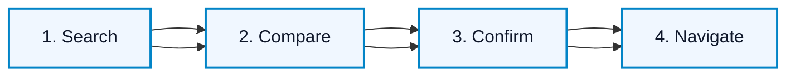
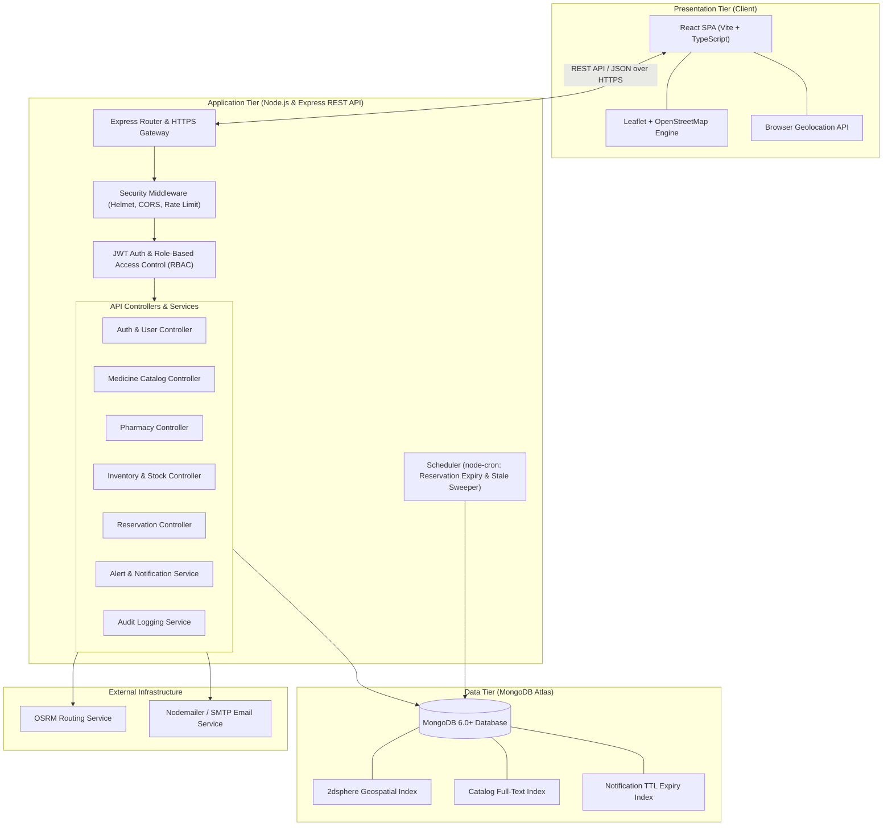

# MediFind — Medicine Availability & Pharmacy Locator

[](https://nodejs.org/)
[](#system-architecture)
[](#specifications-and-compliance)
[](https://www.mongodb.com/)
[](LICENSE)

> **MediFind** is a healthcare discovery and navigation web platform designed to bridge the gap between patients in urgent need of prescription or critical medicines and nearby verified pharmacies that currently report them in stock.

---

## Table of Contents

- [Problem Statement & Solution](#problem-statement--solution)
- [Project Mission & Objectives](#project-mission--objectives)
- [Scope Boundaries & Disclaimers](#scope-boundaries--disclaimers)
- [Primary User Journey](#primary-user-journey)
- [Core Features & System Capabilities](#core-features--system-capabilities)
  - [Customer & Patient Experience](#1-customer--patient-experience)
  - [Pharmacy Management & Inventory Control](#2-pharmacy-management--inventory-control)
  - [Administrative Moderation & Governance](#3-administrative-moderation--governance)
- [System Architecture](#system-architecture)
- [Technology Stack](#technology-stack)
- [Repository Structure](#repository-structure)
- [Data Model & Entities](#data-model--entities)
- [API Contract Starter](#api-contract-starter)
- [Security & Threat Mitigation](#security--threat-mitigation)
- [Non-Functional Requirements & Performance](#non-functional-requirements--performance)
- [Data Privacy & Retention Policies](#data-privacy--retention-policies)
- [Definition of Done & Quality Standards](#definition-of-done--quality-standards)
- [Getting Started & Local Development](#getting-started--local-development)
  - [Prerequisites](#prerequisites)
  - [Environment Variables](#environment-variables)
  - [Backend Setup](#backend-setup)
  - [Frontend Setup](#frontend-setup)
  - [Database Seeding](#database-seeding)
- [Testing Strategy](#testing-strategy)
- [Contribution & Working Agreement](#contribution--working-agreement)
- [Documentation Index](#documentation-index)

---

## Problem Statement & Solution

### The Problem
When patients or family members urgently need essential or scarce medications, they are frequently forced to travel to or call multiple pharmacies individually. In moments of medical stress, there is no centralized, real-time mechanism to identify which local pharmacy currently holds the required medication, leading to delayed treatments, critical health risks, and wasted travel.

### The Solution
**MediFind** provides an intuitive, real-time medicine availability search and navigation platform. Users can search by generic name, brand name, or dosage strength, view nearby licensed pharmacies on an interactive map, inspect inventory freshness indicators, place temporary holds, and immediately receive turn-by-turn navigation routes or direct phone contact details.

---

## Project Mission & Objectives

- **Rapid Emergency Discovery:** Enable patients to locate reported medicine stock and initiate route navigation in three taps or fewer.
- **Freshness & Trust Transparency:** Expose real-time status and transparent update timestamps (`Updated recently` vs. `May be outdated`), actively preventing unnecessary travel.
- **Frictionless Inventory Maintenance:** Empower verified pharmacy operators to update their inventory availability with a single action.
- **Rigorous Verification & Safety:** Maintain strict administrative oversight to verify pharmacy credentials, drug licenses, and moderate crowdsourced inaccuracy reports.

---

## Scope Boundaries & Disclaimers

### Scope Boundaries
To maintain high regulatory compliance, safety, and security:
- **Informational Service Only:** MediFind connects seekers to physical pharmacies. It does **not** process financial transactions, fulfill online payments, or operate courier/home delivery services.
- **No Diagnostic or Prescription Services:** The system does **not** provide medical diagnoses, treatment recommendations, dosage determinations, or automated drug interaction checks.
- **Prescription Compliance:** Controlled and prescription-only substances are flagged strictly according to regulatory standards (e.g., Directorate General of Drug Administration - DGDA). Valid physical prescriptions remain mandatory at the dispensing pharmacy.
- **Reported vs. Guaranteed Stock:** Inventory status represents data reported by pharmacies and does not represent an infallible legal guarantee of instantaneous shelf stock.

### Medical & Emergency Safety Disclaimer
> [!IMPORTANT]
> **Medical Disclaimer:** MediFind is an information and navigation discovery service, **not** an emergency response service or licensed medical provider. In a life-threatening medical emergency, immediately contact local emergency services or proceed to the nearest hospital emergency room. Always call the pharmacy before traveling to confirm real-time availability.

---

## Primary User Journey

The core end-to-end user journey is built around 4 clear steps:



1. **Search:** The user queries a medication by brand, generic name, or dosage form (e.g., *Paracetamol 500mg*, *Omeprazole 20mg*).
2. **Compare:** The system lists matching nearby licensed pharmacies sorted by proximity, displaying inventory availability (`Available`, `Low`, `Out of Stock`), last-updated timestamp, and operating hours.
3. **Confirm:** The user reviews pharmacy contact details, clicks to place an optional time-limited reservation hold, or directly initiates a phone call to confirm physical stock.
4. **Navigate:** The user opens the interactive map route (or hands off to Google Maps/external navigation) to reach the verified pharmacy in person.

---

## Core Features & System Capabilities

### 1. Customer & Patient Experience
- **Smart Medicine Search:** Fast, case-insensitive autocomplete search with live suggestions by brand name, generic compound, and dosage strength.
- **Location & Geolocation Intelligence:** Automatic browser geolocation detection with graceful fallback to manual neighborhood/address entry.
- **Interactive Proximity Map:** Leaflet/OpenStreetMap interface displaying verified pharmacies, color- and symbol-coded stock pins, and distance calculations.
- **Routing & Travel Estimates:** Route geometry, driving/walking distances, and estimated travel times powered by OSRM (with straight-line fallback).
- **Time-Limited Medicine Reservation:** Reserve available stock units for a configurable window (default: 2 hours, maximum: 4 hours) to travel with confidence.
- **Availability Subscriptions & Alerts:** Subscribe to out-of-stock medications within a chosen geographic radius; receive instant notifications when restocked.
- **Crowdsourced Accuracy Reporting:** Flag incorrect inventory or contact information to trigger system audits and preserve data integrity.

### 2. Pharmacy Management & Inventory Control
- **Pharmacy Registration & Onboarding:** Self-service registration including official drug license number, geospatial pin location, address, phone, and operating hours.
- **One-Tap Inventory Management:** Update medicine stock status (`Available`, `Low`, `Out of Stock`) in under 5 seconds from a responsive dashboard.
- **Quantity Tracking:** Optional exact unit tracking that automatically switches status to `Out of Stock` upon reaching zero.
- **Reservation Queue Management:** Dedicated queue to review incoming user holds, confirm holds, mark medicines as collected, or release reservations with reason codes.
- **Local Demand Insights:** Privacy-preserving visibility into high-demand medicines searched in the pharmacy's geographic perimeter that are not currently stocked.

### 3. Administrative Moderation & Governance
- **Pharmacy Verification Queue:** Admin portal to review pending pharmacy submissions, validate drug license numbers against regulatory databases, confirm telephone details, and approve or reject listings.
- **Curated Medicine Catalog Management:** Centralized administrative CRUD for medicines, generic equivalents, dosage forms, manufacturers, and regulatory prescription requirements.
- **Dispute & Report Resolution:** Review and investigate user-reported stock discrepancies; automatically demote disputed items to `Unverified` status until confirmed.
- **Comprehensive Immutable Audit Log:** Append-only logging of critical administrative operations, license approvals, role adjustments, and inventory modifications.
- **System Threshold Configuration:** Adjust system-wide parameters including stale inventory thresholds, reservation hold lifetimes, rate limits, and default search radii.

---

## System Architecture

MediFind follows a decoupled, stateless **3-Tier Architecture** engineered for high availability, security, and low-latency geospatial querying:



---

## Technology Stack

| Layer | Technology | Key Dependencies / Libraries |
| :--- | :--- | :--- |
| **Frontend (Presentation)** | React 19, TypeScript, Vite | `leaflet`, `lucide-react`, Vanilla CSS / Modern Design Tokens |
| **Backend (Application)** | Node.js (LTS), Express 5, TypeScript | `jsonwebtoken`, `bcrypt`, `cors`, `helmet`, `express-rate-limit`, `node-cron`, `nodemailer` |
| **Database (Data Tier)** | MongoDB Atlas 6.0+ | `mongoose` (Mongoose 9 ODM with `2dsphere` spatial indexing) |
| **Geospatial & Mapping** | OpenStreetMap, Leaflet, OSRM | Browser Geolocation API, OpenStreetMap Tile Servers, OSRM HTTP API |
| **Quality & Tooling** | TypeScript, Jest, Supertest | ESLint, Prettier, nodemon, ts-node |

---

## Repository Structure

MediFind is organized as a clean, modular repository with distinct client, server, and documentation workspaces:

```text
medifind/
├── frontend/                     # React Single-Page Application (Vite + TypeScript)
│   ├── public/                   # Static assets, icons, and map markers
│   ├── src/
│   │   ├── app/                  # Application routing, layout wrappers, and providers
│   │   ├── components/           # Reusable shared UI primitives (Navbar, Modal, Badges, Cards)
│   │   ├── features/             # Domain-specific feature modules
│   │   │   ├── customer/         # Search, result cards, interactive map, reservation modal
│   │   │   ├── pharmacy/         # Pharmacy dashboard, one-tap stock manager, reservation queue
│   │   │   └── admin/            # Verification queue, catalog editor, audit viewer
│   │   ├── services/             # Axios/Fetch API client and HTTP request handlers
│   │   ├── index.css             # Design tokens, typography, and responsive styles
│   │   └── main.tsx              # React application entry point
│   ├── package.json              # Frontend dependencies and Vite build scripts
│   └── tsconfig.json             # Frontend TypeScript configuration
│
├── backend/                      # Node.js + Express REST API (TypeScript)
│   ├── src/
│   │   ├── config/               # Database, JWT, SMTP, and environment configurations
│   │   ├── controllers/          # Request handlers and business logic orchestration
│   │   ├── middleware/           # JWT authentication, role guards (RBAC), error handlers
│   │   ├── models/               # Mongoose schemas and data layer models
│   │   ├── routes/               # Modular Express API route declarations
│   │   ├── services/             # Core business services (geospatial, routing, email)
│   │   ├── jobs/                 # Cron tasks (reservation auto-expiry, stale stock checks)
│   │   ├── validators/           # Request body schema validation & sanitization
│   │   ├── app.ts                # Express application setup and middleware pipeline
│   │   └── server.ts             # Server entry point and database connection lifecycle
│   ├── tests/                    # Automated API, unit, and integration test suites
│   ├── package.json              # Backend dependencies and execution scripts
│   └── tsconfig.json             # Backend TypeScript configuration
│
├── docs/                         # Engineering and architecture documentation
│   ├── PRD.md                    # Product Requirements Document
│   ├── ERD.md                    # Entity Relationship Diagram & Data Dictionary
│   ├── API.md                    # REST API specifications and contracts
│   ├── Testing.md                # Test plans, security verification, and QA checklist
│   └── Deployment.md             # Production hosting and environment configuration guide
│
├── .gitignore                    # Git ignore specifications
└── README.md                     # Central project overview and technical documentation
```

---

## Data Model & Entities

The system uses 10 core normalized collections within MongoDB:

| Entity | Primary Attributes | Indexes & Purpose |
| :--- | :--- | :--- |
| **User** | `name`, `email`, `phone`, `passwordHash`, `role`, `status`, `createdAt` | Unique index on `email`. Roles: `CUSTOMER`, `PHARMACY`, `ADMIN`. |
| **Pharmacy** | `ownerId`, `name`, `address`, `location`, `phone`, `licenseNo`, `openingHours`, `verificationStatus`, `verifiedBy` | `2dsphere` geospatial index on `location`. Unique index on `licenseNo`. |
| **Medicine** | `brandName`, `genericName`, `strength`, `dosageForm`, `manufacturer`, `prescriptionRequired`, `active`, `source` | Full-text index on `brandName` and `genericName`. |
| **Stock** | `pharmacyId`, `medicineId`, `status`, `quantity`, `quantityBand`, `lastUpdated`, `updatedBy` | Compound unique index on `{ pharmacyId, medicineId }`. Status: `Available`, `Low`, `Out of Stock`, `Unverified`. |
| **StockHistory** | `pharmacyId`, `medicineId`, `oldStatus`, `newStatus`, `changedBy`, `changedAt` | Append-only historical audit trail of stock transitions. |
| **StockReport** | `reporterId`, `pharmacyId`, `medicineId`, `reason`, `status`, `createdAt`, `resolvedBy` | Crowdsourced inaccuracy reports; rate-limited to 1 report per user per pharmacy/24h. |
| **Reservation** | `userId`, `pharmacyId`, `medicineId`, `quantity`, `status`, `expiresAt`, `createdAt`, `resolvedAt` | Hold tracking. Lifecycle: `Pending` → `Confirmed` → `Collected` / `Expired` / `Cancelled`. |
| **Subscription** | `userId`, `medicineId`, `location`, `radius`, `status`, `expiresAt`, `createdAt` | Out-of-stock medicine alert subscriptions. Closes upon notification or 30 days. |
| **Notification** | `userId`, `type`, `message`, `read`, `createdAt` | In-app user alerts. TTL index on `createdAt` for automated pruning (90 days). |
| **AuditLog** | `actorId`, `action`, `targetType`, `targetId`, `details`, `createdAt` | Immutable, append-only log of security, moderation, and inventory events. |

---

## API Contract Starter

All endpoints communicate via JSON over HTTPS. Protected endpoints require a valid Bearer token in the `Authorization` header (`Authorization: Bearer <TOKEN>`).

### Public & Authentication Endpoints
- `POST /api/auth/register` — Create a customer or pharmacy account.
- `POST /api/auth/login` — Authenticate credentials and return signed JWT token.
- `GET /api/medicines/search?q=` — Case-insensitive search across brand and generic catalog.
- `GET /api/medicines/:id` — Detailed view of medicine specifications and disclaimer.
- `GET /api/pharmacies?lat=&lng=&radius=` — Geospatial search for pharmacies within radius (default: 5km).
- `GET /api/pharmacies/:id` — Pharmacy profile, verified status, operating hours, and location.
- `GET /api/inventory/search?medicineId=&lat=&lng=&radius=` — Find nearby pharmacies with reported availability for a selected medicine.
- `GET /api/route?fromLat=&fromLng=&toId=` — Calculate travel route, distance, and geometry to target pharmacy.

### Protected Customer Endpoints
- `POST /api/reservations` — Create a time-limited hold on medicine at a pharmacy.
- `PATCH /api/reservations/:id/cancel` — Cancel an active reservation.
- `POST /api/subscriptions` — Subscribe to notifications for an out-of-stock medication.
- `DELETE /api/subscriptions/:id` — Unsubscribe from stock alert.
- `POST /api/reports` — Submit crowdsourced report of incorrect stock or pharmacy data.
- `GET /api/notifications` — View user notifications with read/unread statuses.

### Protected Pharmacy Owner Endpoints
- `POST /api/pharmacies` — Submit a pharmacy registration and license for verification.
- `POST /api/inventory` — Add a medicine catalog entry to pharmacy inventory.
- `PATCH /api/inventory/:id` — Perform rapid one-tap availability/quantity updates.
- `GET /api/pharmacy/reservations` — View incoming reservation queue.
- `PATCH /api/reservations/:id` — Confirm, release (with reason), or mark reservation as collected.

### Protected Administrator Endpoints
- `PATCH /api/admin/pharmacies/:id/verification` — Approve, reject, or suspend a pharmacy registration.
- `POST /api/admin/medicines` — Create a new verified medicine catalog entry.
- `PATCH /api/admin/medicines/:id` — Edit or deactivate an existing medicine entry.
- `GET /api/admin/reports` — Review pending inaccurate availability flags.
- `PATCH /api/admin/reports/:id` — Resolve or dismiss an inaccuracy report.
- `GET /api/admin/audit` — Query append-only audit logs with actor and date filters.

---

## Security & Threat Mitigation

MediFind aligns with OWASP Top 10 recommendations and ISO/IEC 29148 standards:

```
+------------------------------------+-----------------------------------------------------+
| Identified Threat                  | System Mitigation Architecture                      |
+------------------------------------+-----------------------------------------------------+
| Fake Pharmacy Registration         | Mandatory manual drug license verification by Admin |
| (T-01)                             | before public discovery listing.                    |
+------------------------------------+-----------------------------------------------------+
| Stale or Misleading Stock Data     | Visible freshness tags ("Updated recently",         |
| (T-02)                             | "May be outdated"), disclaimers, & auto-staleness.  |
+------------------------------------+-----------------------------------------------------+
| Unauthorized Stock Mutation        | Strict server-side RBAC; ownership verification on  |
| (T-03)                             | every mutation against the authenticated token.     |
+------------------------------------+-----------------------------------------------------+
| Reservation Hoarding               | Maximum 2 active holds per user; automated cron hold|
| (T-04)                             | expiration (default 2h); pharmacy release action.   |
+------------------------------------+-----------------------------------------------------+
| Credential Stuffing & Brute Force  | bcrypt hashing (cost factor >= 10); aggressive rate |
| (T-05)                             | limiting via express-rate-limit; account lockouts.  |
+------------------------------------+-----------------------------------------------------+
| NoSQL / Script Injection           | Strict input validation, query sanitization, and    |
| (T-06)                             | prohibiting unvalidated object queries in Mongoose. |
+------------------------------------+-----------------------------------------------------+
| Sensitive Location Leakage         | Ephemeral location usage: coordinates processed in  |
| (T-07)                             | memory during query; never logged to disk or DB.    |
+------------------------------------+-----------------------------------------------------+
| Token Theft & Session Hijacking    | Enforce HTTPS-only traffic, short-lived JWT expiries|
| (T-08)                             | Helmet security headers, and strict CORS whitelist. |
+------------------------------------+-----------------------------------------------------+
```

---

## Non-Functional Requirements & Performance

- **Sub-Second Search Latency:** Autocomplete medicine suggestions return within **1 second** for 95% of queries (`PERF-1`).
- **Geospatial Efficiency:** Nearby availability queries complete within **2 seconds** for 95% of requests over 5,000+ pharmacies using indexed `2dsphere` evaluation (`PERF-2`).
- **Mobile-First Responsiveness:** Application initial bundle becomes interactive within **3 seconds** on standard mobile connections, accommodating screens down to **360px** width (`PERF-3`, `USA-5`).
- **One-Tap Speed:** Pharmacy dashboard status updates persist in under **5 seconds** from interaction (`USA-6`).
- **Resilient Fallbacks:** In the event of OSRM routing downtime, the platform gracefully defaults to straight-line Euclidean/Haversine distance calculation without terminating the search experience (`REL-3`).
- **Concurrency & Scaling:** Stateless Node.js server design accommodates horizontal scaling and supports 100+ concurrent users with error rates < 1% (`PERF-5`, `SCL-1`).

---

## Data Privacy & Retention Policies

In compliance with data protection principles and data minimization standards:
- **Search Geolocation:** Used ephemerally in-flight to compute distance vectors; never persisted to databases or application server logs.
- **Alert Geolocation:** Coarse coordinates stored solely for active alerts; permanently removed upon alert closure or 30-day expiration.
- **User Accounts:** Users retain full rights to request account and credential deletion; fulfilled within 30 days.
- **Reservation Records:** Held for 12 months for dispute resolution and pharmacy data reliability calculations, subsequently anonymized.
- **Audit Logs:** Preserved in append-only storage for 24 months for regulatory accountability, then permanently archived and purged.

---

## Definition of Done & Quality Standards

A feature is considered complete only when it satisfies all of the following:
1. **Happy Path Validated:** Core user workflow functions end-to-end on both mobile and desktop screen sizes.
2. **Server-Side Enforcement:** Role authorization, ownership validation, and input sanitization operate on the backend, independent of UI guards.
3. **Graceful Degeneration:** Meaningful loading spinners, empty states, network failure alerts, and fallbacks are presented to the user.
4. **Automated Test Coverage:** Underlying business logic and API contracts are protected with unit and integration tests.
5. **No Secret Leaks:** Clean git status free of hardcoded API tokens, private keys, or staging database credentials.

---

## Getting Started & Local Development

### Prerequisites
- **Node.js**: v18.x or v20.x LTS installed
- **npm**: v9.x or higher
- **MongoDB**: Local MongoDB instance (v6.0+) or MongoDB Atlas connection URI

### Environment Variables

#### Backend (`backend/.env`)
Create a `.env` file in the `backend/` directory based on the following template:

```env
# Server Configuration
PORT=5000
NODE_ENV=development
CLIENT_URL=http://localhost:5173

# Database Connection
MONGODB_URI=mongodb://localhost:27017/medifind

# Security & Authentication
JWT_SECRET=your_super_secret_jwt_key_here
JWT_EXPIRES_IN=1d

# External Routing Service (OSRM)
OSRM_BASE_URL=https://router.project-osrm.org

# Email Service (SMTP)
SMTP_HOST=smtp.mailtrap.io
SMTP_PORT=2525
SMTP_USER=your_smtp_username
SMTP_PASS=your_smtp_password
EMAIL_FROM=no-reply@medifind.org

# Operational Thresholds
STALE_THRESHOLD_HOURS=24
RESERVATION_HOLD_HOURS=2
MAX_ACTIVE_RESERVATIONS=2
REPORT_THRESHOLD_FOR_UNVERIFIED=3
```

#### Frontend (`frontend/.env`)
Create a `.env` file in the `frontend/` directory:

```env
VITE_API_BASE_URL=http://localhost:5000/api
```

### Backend Setup
1. Open a terminal and navigate to the backend workspace:
   ```bash
   cd backend
   ```
2. Install dependencies:
   ```bash
   npm install
   ```
3. Start the backend in development mode:
   ```bash
   npm run dev
   ```
   *The API server will listen on `http://localhost:5000` with active TypeScript reloading.*

### Frontend Setup
1. Open a second terminal and navigate to the frontend workspace:
   ```bash
   cd frontend
   ```
2. Install dependencies:
   ```bash
   npm install
   ```
3. Start the Vite development server:
   ```bash
   npm run dev
   ```
   *Access the web application at `http://localhost:5173`.*

### Database Seeding
To populate the database with realistic medicines, geo-referenced pharmacies, and baseline stock for testing:
```bash
cd backend
npm run seed
```

---

## Testing Strategy

MediFind enforces a multi-tier testing strategy to ensure reliability and security:

```bash
# Execute backend test suite
cd backend
npm test

# Run tests with test coverage reporting
npm run test:coverage
```

- **Unit Tests:** Verify business algorithms including distance calculations, freshness label generators, opening/closing hour parsers, and schema validators.
- **API Integration Tests (`Jest` + `Supertest`):** Test end-to-end HTTP request/response lifecycles, authentication headers, error codes, and database state transitions.
- **Security & Authorization Tests:** Verify that non-admin tokens cannot access admin moderation endpoints and pharmacies cannot modify competitor inventories.
- **Cross-Browser & Responsive QA:** Test layout responsiveness on Chrome, Firefox, Edge, and Safari across viewports from 360px mobile to 4K desktop.

---

## Contribution & Working Agreement

To maintain code health and collaborative velocity:

### 1. Branching Strategy
- `main`: Production-ready, stable codebase.
- `develop`: Primary integration branch.
- Feature branches branched from `develop` using clear prefixes:
  - `feature/<feature-name>` — New feature implementations.
  - `fix/<bug-description>` — Bug fixes and security patches.
  - `docs/<documentation-topic>` — Documentation additions and refinements.

### 2. Commit Message Convention
Commits must follow the Conventional Commits specification:
- `feat: add geospatial radius filter to pharmacy search`
- `fix: prevent duplicate stock report creation within 24h`
- `docs: update API specification for reservation lifecycle`
- `test: add integration test for unverified stock status transition`

### 3. Pull Request Guidelines
- All PRs must target `develop`.
- PR descriptions must detail:
  - Summary of changes and underlying rationale.
  - Screenshots or terminal output of test evidence.
  - Known limitations or environment considerations.
- Every PR requires review and approval from at least one teammate prior to merge.

---

## Documentation Index

Comprehensive engineering specifications are maintained in the [docs/](file:///d:/code%20dump/medifind/docs) directory:

- [Product Requirements Document (PRD)](file:///d:/code%20dump/medifind/docs/PRD.md)
- [REST API Specifications & Contracts](file:///d:/code%20dump/medifind/docs/API.md)
- [Entity Relationship Diagram & Schema Dictionary](file:///d:/code%20dump/medifind/docs/ERD.md)
- [Testing & Quality Assurance Guide](file:///d:/code%20dump/medifind/docs/Testing.md)
- [Deployment & Infrastructure Guide](file:///d:/code%20dump/medifind/docs/Deployment.md)

---

## License & Attribution

- **License:** Released under the [MIT License](LICENSE).
- **Map Data Attribution:** Map tiles & geographic features provided by [OpenStreetMap](https://www.openstreetmap.org/) contributors under the Open Database License (ODbL).
- **Routing Engine:** Routing calculations powered by [Project OSRM](http://project-osrm.org/).
