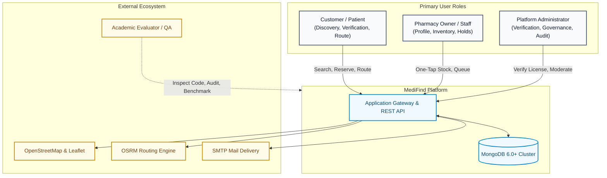
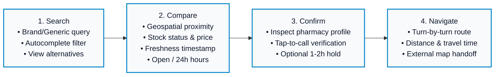
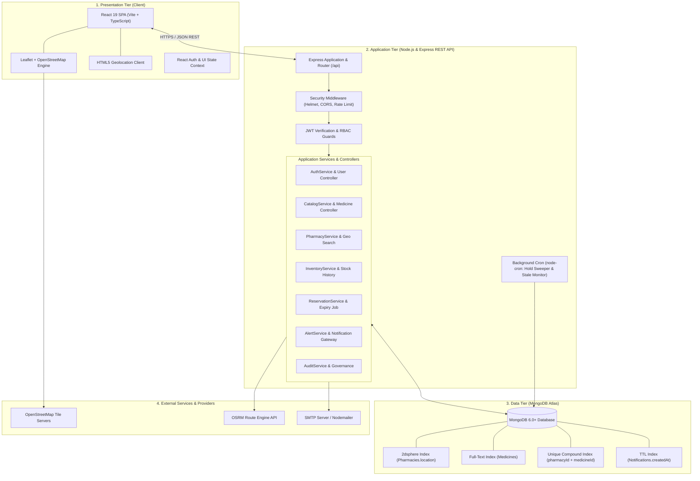
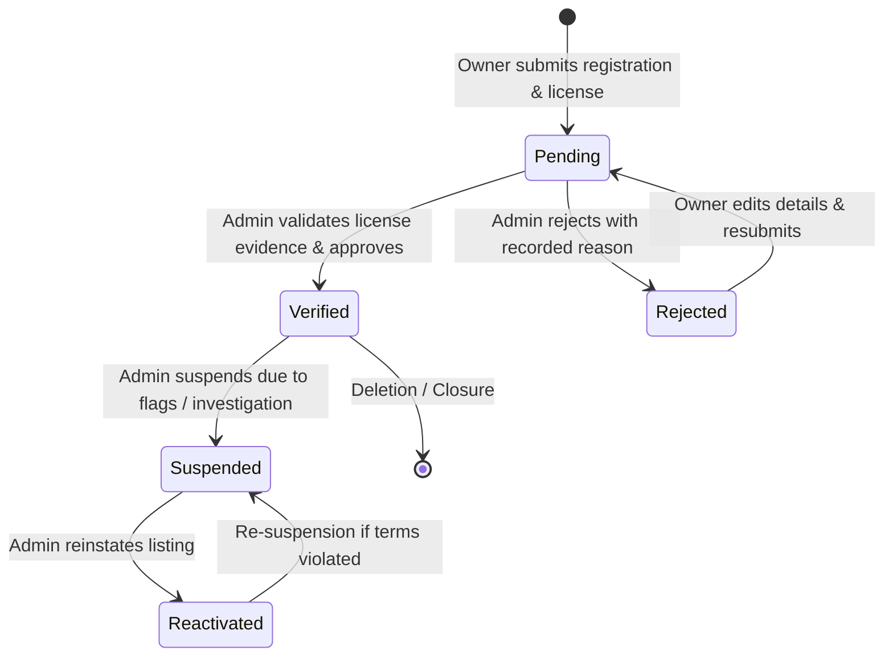
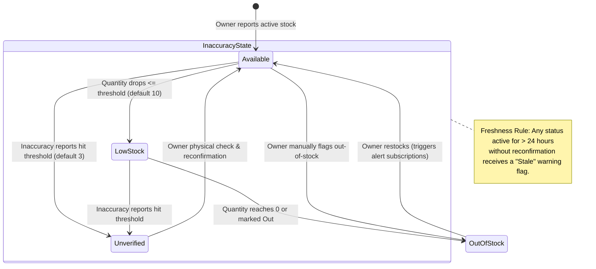
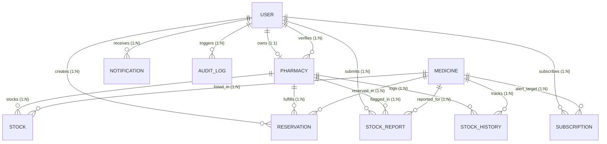

# MediFind — Medicine Availability & Pharmacy Locator

[](https://nodejs.org/)
[](https://www.typescriptlang.org/)
[](#system-architecture)
[](#standards-and-compliance)
[](https://www.mongodb.com/)
[](#uiux-design-system--accessibility)
[](LICENSE)

> **MediFind** is a healthcare discovery and navigation web platform engineered to bridge the critical gap between patients searching for prescription or essential medicines and nearby verified pharmacies reporting active availability. By combining proximity geospatial querying, transparent inventory freshness indicators, rapid one-tap pharmacy updates, and external navigation routing, MediFind reduces wasted travel and prevents delayed medical treatments.

---

## Table of Contents

- [Problem Statement & Proposed Solution](#problem-statement--proposed-solution)
- [Mission, Objectives & Phased Scope](#mission-objectives--phased-scope)
  - [Project Objectives](#project-objectives)
  - [Scope Register & Release Phasing](#scope-register--release-phasing)
  - [Medical & Safety Disclaimers](#medical--safety-disclaimers)
- [Stakeholders & User Profiles](#stakeholders--user-profiles)
  - [Stakeholder Ecosystem & Matrix](#stakeholder-ecosystem--matrix)
  - [User Archetypes & Behavioral Boundaries](#user-archetypes--behavioral-boundaries)
- [End-to-End User Journeys](#end-to-end-user-journeys)
  - [Primary Customer Journey](#primary-customer-journey)
  - [3–5 Minute End-to-End Demonstration Script](#35-minute-end-to-end-demonstration-script)
- [System Architecture & Engineering Design](#system-architecture--engineering-design)
  - [3-Tier Block Architecture](#3-tier-block-architecture)
  - [External Dependencies & Graceful Degradation](#external-dependencies--graceful-degradation)
- [System Lifecycles & State Transitions](#system-lifecycles--state-transitions)
  - [1. Pharmacy Verification Lifecycle](#1-pharmacy-verification-lifecycle)
  - [2. Inventory & Stock Freshness Lifecycle](#2-inventory--stock-freshness-lifecycle)
  - [3. Medicine Reservation Lifecycle](#3-medicine-reservation-lifecycle)
- [Use Case Model & Traceability](#use-case-model--traceability)
  - [Actor-to-System Use Cases](#actor-to-system-use-cases)
  - [Use Case Associations & UML Relationships](#use-case-associations--uml-relationships)
- [Functional Capabilities & Business Rules](#functional-capabilities--business-rules)
  - [Functional Modules Summary (54 Requirements)](#functional-modules-summary-54-requirements)
  - [Core Business Rules (BR-01 to BR-22)](#core-business-rules-br-01-to-br-22)
- [Data Model & Database Specifications](#data-model--database-specifications)
  - [Entity-Relationship Diagram](#entity-relationship-diagram)
  - [Data Dictionary & Collection Schemas](#data-dictionary--collection-schemas)
  - [Indexing Strategy & Performance Optimization](#indexing-strategy--performance-optimization)
- [REST API Contract & Endpoints](#rest-api-contract--endpoints)
  - [API Architectural Standards](#api-architectural-standards)
  - [Complete 49-Endpoint Specification](#complete-49-endpoint-specification)
- [UI/UX Design System & Accessibility](#uiux-design-system--accessibility)
  - [Design Philosophy & Semantic Color Tokens](#design-philosophy--semantic-color-tokens)
  - [Mobile Responsiveness & Usability Rules](#mobile-responsiveness--usability-rules)
- [Security Architecture & Threat Mitigation](#security-architecture--threat-mitigation)
  - [OWASP Threat Mitigation Matrix](#owasp-threat-mitigation-matrix)
  - [Role-Based Access Control (RBAC) & Ownership Checks](#role-based-access-control-rbac--ownership-checks)
  - [Data Privacy & Ephemeral Geolocation Retention](#data-privacy--ephemeral-geolocation-retention)
- [Non-Functional Requirements & Performance Benchmarks](#non-functional-requirements--performance-benchmarks)
- [Repository Structure](#repository-structure)
- [Getting Started & Local Development](#getting-started--local-development)
  - [Prerequisites](#prerequisites)
  - [Environment Configuration](#environment-configuration)
  - [Backend Setup](#backend-setup)
  - [Frontend Setup](#frontend-setup)
  - [Database Seeding](#database-seeding)
- [Testing Strategy & Verification Checklist](#testing-strategy--verification-checklist)
  - [Test Hierarchy](#test-hierarchy)
  - [Security & Acceptance Verification Checklist](#security--acceptance-verification-checklist)
  - [Definition of Done](#definition-of-done)
- [Collaboration & Engineering Standards](#collaboration--engineering-standards)
  - [Branching Strategy](#branching-strategy)
  - [Conventional Commits](#conventional-commits)
  - [Pull Request Governance](#pull-request-governance)
- [Documentation Index](#documentation-index)
- [Standards, Attribution & License](#standards-attribution--license)

---

## Problem Statement & Proposed Solution

### The Problem
Patients and caregivers in urgent need of scarce, specialized, or everyday medicines frequently experience high physical and emotional stress. Because pharmacies manage independent, disconnected retail inventories, seekers must call multiple shops or travel door-to-door without any prior certainty of stock. This friction results in:
- Delayed treatments for critical conditions (e.g., pediatric antipyretics, insulin, respiratory inhalers, antibiotics).
- Unnecessary commuting costs and congestion during medical emergencies.
- Information asymmetry where local community pharmacies hold surplus inventory while nearby patients remain unaware.

### The Proposed Solution
**MediFind** is a centralized, mobile-first availability discovery engine and pharmacy directory. It allows patients to search medications by brand or generic name, view verified pharmacies within a configurable radius, evaluate stock freshness timestamps, hold units via short-term reservations, and launch turn-by-turn navigation or direct telephone calls. For pharmacy operators, it provides a lightweight workbench to report inventory status in seconds, eliminating operational friction.

---

## Mission, Objectives & Phased Scope

### Project Objectives
1. **Rapid Emergency Discovery:** Allow patients to locate reported medicine stock, inspect operating hours, and initiate contact or navigation in **3 clicks or taps or fewer** (`NFR-17`).
2. **Freshness & Trust Transparency:** Expose transparent, human-readable update timestamps (`Updated 12 min ago` vs. `Stale / May be outdated`), actively preventing misinformed travel (`BR-09`, `BR-19`).
3. **Low-Friction Inventory Maintenance:** Enable verified pharmacy operators to update stock status (`Available`, `Low`, `Out of Stock`) in **under 5 seconds** (`USA-6`).
4. **Rigorous Credentialing & Moderation:** Protect data integrity by enforcing mandatory administrative verification of government-issued drug licenses prior to public listing (`BR-01`, `BR-02`).

### Scope Register & Release Phasing

The project features are strictly partitioned to guarantee an auditable, high-confidence delivery:

```
+---------------------------------------------------------------------------------------------------+
|                                      MEDIFIND SCOPE REGISTER                                     |
+----------------------------------------------------+----------------------------------------------+
| INCLUDED | MVP Core (P0)                           | INCLUDED IN FULL SPEC | Phase 2 (P1)         |
+----------------------------------------------------+----------------------------------------------+
| • Medicine catalog search (Brand/Generic/Strength) | • Time-limited reservations (1–2h hold,      |
| • Medicine details & same-generic alternatives     |   owner queue, confirmation, pickup mark)    |
| • Geospatial pharmacy discovery ($near/2dsphere)   | • Stock availability alert subscriptions     |
| • Browser Geolocation with manual area fallback    | • In-app notification center & email notices |
| • Dual Map (Leaflet/OSM) & List parity             | • Crowdsourced incorrect-stock reporting     |
| • Distance sorting, open/closed, 24h status        | • Automated "Unverified" demotion thresholds |
| • Pharmacy profile, license verification queue     | • Pharmacy review & star rating system       |
| • One-tap inventory workbench (Avail/Low/Out)      | • Customer saved favorites & search history  |
| • Turn-by-turn external route handoff (OSRM/Maps)  | • Pharmacy search demand analytics           |
| • Server-side RBAC, Helmet, rate limiting, bcrypt  | • CSV exports & audit trail query filters    |
+----------------------------------------------------+----------------------------------------------+
| EXCLUDED FROM CURRENT PRODUCT (Out of Scope / Non-Goals)                                          |
+---------------------------------------------------------------------------------------------------+
| • Online pharmacy e-commerce, checkout, and digital payment processing.                           |
| • Home medicine delivery or courier fulfillment logistics.                                       |
| • Automated live synchronization with proprietary pharmacy ERP / POS systems (manual updates).    |
| • Medical diagnostic advice, automated dosage calculation, or drug interaction warnings.         |
| • Real-time WebSockets, push notifications, or SMS gateways (asynchronous REST & polling).        |
| • Guaranteed shelf stock (all data is pharmacy-reported and subject to physical shelf movements). |
+---------------------------------------------------------------------------------------------------+
```

### Medical & Safety Disclaimers

> [!IMPORTANT]
> **Informational Service Disclaimer:** MediFind is strictly an information discovery, directory, and route navigation service. It is **not** a licensed pharmacy, drug manufacturer, prescribing practitioner, or healthcare provider. MediFind does **not** dispense medications, provide medical advice, evaluate drug interactions, or recommend dosages.
>
> **Emergency Care Protocol:** In a critical or life-threatening medical emergency, do not rely on web search—immediately call local emergency services or visit the nearest hospital emergency department.
>
> **Prescription Compliance:** Controlled and prescription-only substances require a valid physical paper or electronic prescription issued by an authorized physician, inspected in-person by a licensed pharmacist at dispensing time. Users are strongly advised to call the pharmacy using the tap-to-call feature to verify physical shelf stock before traveling.

---

## Stakeholders & User Profiles

### Stakeholder Ecosystem & Matrix



| Stakeholder Group | Role & Context | Primary Need & Success Signal | Architectural Boundary / Safeguard |
| :--- | :--- | :--- | :--- |
| **Customers / Patients** | Public seekers looking for medicines; frequent mobile usage under time stress. | Find verified open stock nearby within 3 taps; launch call/route without instruction. | Guest search access; authentication required only for reservations, alerts, and reports. |
| **Pharmacy Owners / Staff** | Retail pharmacy operators; frequent daily interactions between physical customers. | Update stock in under 5 seconds; clear pending/verified status visibility. | Strict tenant boundary; server enforces ownership checks on every inventory write. |
| **Platform Administrators** | System moderators ensuring directory integrity and trust. | Review submitted drug licenses; resolve inaccuracy reports; audit all events. | Role-guarded endpoints (`/api/admin/*`); append-only audit trail; seeded accounts only. |
| **Evaluators / Reviewers** | Project evaluators assessing architecture, code quality, and compliance. | Verifiable architecture, reproducible setup, automated test evidence, and PRD alignment. | Isolated staging database, automated test suite, seed fixtures, and comprehensive docs. |

### User Archetypes & Behavioral Boundaries

#### 1. Customer / Patient Profile
- **Context:** Looking for medicine for themselves or family members, often under urgent circumstances from a mobile device.
- **Needs:** Fast autocomplete search, clear distance and operating hours, explicit stock status (`Available`, `Low Stock`, `Out of Stock`), visible last-updated timestamps, and fallback options when map routing is unavailable.
- **Boundary:** Can search anonymously without registration. Account creation is required only to place reservations, subscribe to restock alerts, or submit inaccuracy flags.

#### 2. Pharmacy Owner & Staff Profile
- **Context:** Managing a physical storefront with high customer foot-traffic and limited time for clerical tasks.
- **Needs:** Rapid onboarding form, unambiguous license verification status (`Pending`, `Verified`, `Rejected`, `Suspended`), 1-tap stock adjustments, and a straightforward queue to handle reservations.
- **Boundary:** Restricted strictly to their own single registered pharmacy. Inventory mutations cannot touch other establishments.

#### 3. Platform Administrator Profile
- **Context:** Platform custodian protecting user trust and ensuring legal compliance.
- **Needs:** Centralized queue to inspect submitted drug license numbers, pharmacy street addresses, and coordinates; catalog curation tools to manage active medicines and generic groupings; review queue for inaccuracy flags.
- **Boundary:** Cannot be registered through public signup endpoints; created strictly through database seeding or administrative promotion.

---

## End-to-End User Journeys

### Primary Customer Journey

The core customer workflow follows four streamlined stages:



### 3–5 Minute End-to-End Demonstration Script

| Time | Persona | Action & Screen Flow | Verifiable System Evidence |
| :---: | :--- | :--- | :--- |
| **0:00–0:35** | **Guest Customer** | Open MediFind landing page. Enter search query (e.g., `Paracetamol 500mg`). View matching generic and brand catalog items. | Instant autocomplete suggestions; no login barrier for public discovery. |
| **0:35–1:20** | **Guest Customer** | Allow browser location or select manual area (e.g., `Dhanmondi, Dhaka`). Compare listed pharmacies by distance, open/closed state, and stock. | Dual list/map synchronization; color and text status tags; `Updated 12 min ago` freshness badge. |
| **1:20–1:55** | **Customer** | Open selected pharmacy profile. Tap phone dialer button. Click "Get Directions" to render route and estimated travel time. | Tap-to-call link triggers `tel:`; OSRM route rendered with distance fallback. |
| **1:55–2:40** | **Pharmacy Owner** | Sign in to Pharmacy Dashboard. Open Inventory Workbench. Click "Out of Stock" button on an existing item. | Action persists in <5 seconds; updated timestamp and status reflect immediately. |
| **2:40–3:15** | **Customer** | Refresh medicine search results in separate browser context. | Customer immediately sees the item reflected as "Out of Stock". |
| **3:15–4:20** | **Customer + Admin** | Authenticated customer reports incorrect stock. Admin signs in, opens Dispute Queue, inspects report, and resolves it. | Report logged in database; status transition and admin action appended to immutable `AuditLog`. |

---

## System Architecture & Engineering Design

### 3-Tier Block Architecture

MediFind is constructed using a decoupled, stateless **3-Tier Architecture**:



### External Dependencies & Graceful Degradation

To ensure mission-critical resilience, MediFind implements fallback mechanisms for all external providers:

```
+---------------------------+--------------------------------+-------------------------------------------------------+
| Dependency                | Primary Responsibility         | Graceful Degradation Strategy                         |
+---------------------------+--------------------------------+-------------------------------------------------------+
| HTML5 Geolocation API     | Obtains precise device coords  | Prompt user for manual neighborhood/area selection;   |
|                           | for proximity distance sorting | default to city center fallback coordinates.          |
+---------------------------+--------------------------------+-------------------------------------------------------+
| OpenStreetMap Tile Server | Renders interactive vector map | If tiles fail or timeout, pharmacy list remains fully |
| (via Leaflet)             | and custom stock markers       | interactive with distance and contact data intact.    |
+---------------------------+--------------------------------+-------------------------------------------------------+
| OSRM Routing Engine       | Calculates turn-by-turn route, | Fall back immediately to straight-line Haversine      |
|                           | driving distance & duration    | distance and launch external Google Maps web link.    |
+---------------------------+--------------------------------+-------------------------------------------------------+
| SMTP Mail Server          | Dispatches transactional email | Queue failures silently in system log; always         |
| (Nodemailer)              | alerts for holds and restocks  | deliver in-app notifications reliably to database.    |
+---------------------------+--------------------------------+-------------------------------------------------------+
```

---

## System Lifecycles & State Transitions

### 1. Pharmacy Verification Lifecycle

Every pharmacy registration begins in a restricted state and must be verified by an administrator before appearing in public customer searches:



### 2. Inventory & Stock Freshness Lifecycle

Stock reporting operates independently from freshness tracking, guaranteeing full visibility into data recency:



### 3. Medicine Reservation Lifecycle

Holds are time-limited, atomic, and safe from double-reservation:

```mermaid
stateDiagram-v2
    [*] --> Requested: Customer selects quantity (1-5) & hold time (1-2h)
    Requested --> Pending: System validates active limits & stock availability
    Pending --> Confirmed: Pharmacy owner accepts hold
    Pending --> Released: Owner rejects / releases with reason code
    Pending --> Cancelled: Customer cancels hold before expiration
    Pending --> Expired: Timer elapsed without owner confirmation
    Confirmed --> Collected: Customer arrives; owner confirms pickup (Stock decremented)
    Confirmed --> Cancelled: Customer cancels hold
    Confirmed --> Expired: Hold timer elapses
    Collected --> [*]
    Released --> [*]
    Cancelled --> [*]
    Expired --> [*]
```



---

## Use Case Model & Traceability

### Actor-to-System Use Cases

The system defines 28 structured use cases across 4 primary actors:

```
+-------------------+-----------------------------------------------------------------------------------------------+
| Actor             | Associated Use Cases                                                                          |
+-------------------+-----------------------------------------------------------------------------------------------+
| **Customer**      | UC-01 (Register), UC-02 (Login), UC-03 (Search Medicine), UC-04 (View Details & Alternatives),|
|                   | UC-05 (Find Nearby Pharmacies), UC-06 (View Pharmacy Profile), UC-07 (Get Directions),       |
|                   | UC-08 (Emergency Mode), UC-09 (Reserve Medicine), UC-10 (View/Cancel Reservations),          |
|                   | UC-11 (Request Availability Alert), UC-12 (View Notifications), UC-13 (Rate & Review),       |
|                   | UC-14 (Report Inaccurate Stock), UC-15 (Favorites & History), UC-16 (Manage Profile)          |
+-------------------+-----------------------------------------------------------------------------------------------+
| **Pharmacy        | UC-01 (Register), UC-02 (Login), UC-12 (View Notifications), UC-16 (Manage Profile),         |
|   Owner**         | UC-17 (Manage Pharmacy Profile & Hours), UC-18 (Add Inventory), UC-19 (Update Stock & Price), |
|                   | UC-20 (View Inventory & Low Stock), UC-21 (Manage Reservation Queue), UC-22 (Search Analytics)|
+-------------------+-----------------------------------------------------------------------------------------------+
| **Administrator** | UC-02 (Login), UC-16 (Manage Profile), UC-23 (Verify Pharmacy License), UC-24 (Manage Users),|
|                   | UC-25 (Manage Pharmacies), UC-26 (Manage Medicine Catalog), UC-27 (Moderate Inaccuracy Flags),|
|                   | UC-28 (View System Reports & Audit Trail)                                                     |
+-------------------+-----------------------------------------------------------------------------------------------+
| **External Map/   | Integrates with UC-05 (Proximity Query), UC-07 (Route Calculation), UC-08 (Emergency Mode),   |
|   Routing API**   | and UC-17 (Location Pin Placement)                                                            |
+-------------------+-----------------------------------------------------------------------------------------------+
```

### Use Case Associations & UML Relationships

- `UC-09 (Reserve Medicine)` **«include»** `UC-02 (Login)` — Reservation requires authenticated session.
- `UC-13 (Rate and Review)` **«include»** `UC-02 (Login)` — Reviews require authenticated session.
- `UC-05 (Find Nearby Pharmacies)` **«include»** `UC-03 (Search Medicine)` — Pharmacy discovery requires medicine selection.
- `UC-04 (View Alternatives)` **«extend»** `UC-03 (Search Medicine)` — Optional display of same-generic brand alternatives.
- `UC-07 (Get Directions)` **«extend»** `UC-06 (View Pharmacy Details)` — Optional external route navigation.
- `UC-11 (Request Notification)` **«extend»** `UC-06 (View Pharmacy Details)` — Conditional trigger for out-of-stock items.
- `UC-10 (View & Cancel Reservation)` **«extend»** `UC-09 (Reserve Medicine)` — Post-creation lifecycle management.

---

## Functional Capabilities & Business Rules

### Functional Modules Summary (54 Requirements)

```
+------------------------------------+--------------------------+-----------+-----------------------------------+
| Module Domain                      | Requirement IDs          | Priorities| Primary Scope & Deliverable       |
+------------------------------------+--------------------------+-----------+-----------------------------------+
| 1. Authentication & Accounts       | FR-01 to FR-05, FR-46    | Must Have | JWT auth, bcrypt hashing, profile |
| 2. Medicine Catalog                | FR-06 to FR-08           | Must Have | Brand/generic search, alternatives|
| 3. Geospatial Discovery & Maps     | FR-09 to FR-17           | Must/Should| 2dsphere search, OSRM, Emergency  |
| 4. Reservations & Holds            | FR-18 to FR-21           | Must/Should| 1–2h holds, auto-expiry, limits   |
| 5. Restock Subscriptions & Alerts  | FR-22 to FR-23, FR-40    | Should Have| Restock triggers, in-app notices  |
| 6. Pharmacy Profile & Hours        | FR-29 to FR-32           | Must Have | Onboarding, 24h & open calc       |
| 7. Inventory Workbench             | FR-33 to FR-39           | Must Have | 1-tap status, threshold logic     |
| 8. Owner Queue & Analytics         | FR-41 to FR-45           | Must/Should| Hold confirmation, search metrics |
| 9. Admin Moderation & Governance   | FR-47 to FR-54           | Must/Should| License review, audit, thresholds |
| 10. Reviews, Favorites & History   | FR-24 to FR-28           | Should/Could| Ratings, reports, favorites     |
+------------------------------------+--------------------------+-----------+-----------------------------------+
```

### Core Business Rules (BR-01 to BR-22)

- **BR-01 (Verification Prerequisite):** Only pharmacies with `status: "approved"` appear in public search results and receive reservations.
- **BR-02 (Single Establishment):** A registered pharmacy owner can manage exactly one pharmacy listing. A new listing remains `pending` until approved.
- **BR-03 (Admin Account Boundary):** Admin accounts cannot be created via public registration; they are seeded directly in the database.
- **BR-04 (Account Uniqueness):** Email addresses are strictly unique across all roles.
- **BR-05 (Account Suspension):** Blocked users are immediately rejected by backend middleware, regardless of token expiration.
- **BR-06 (Data Isolation):** Owners can modify only their own pharmacy records. Customers can access only their own reservations, alerts, and favorites.
- **BR-07 (Inventory Uniqueness & Bounds):** A medicine can appear only once in a pharmacy's inventory. Quantity and price cannot be negative.
- **BR-08 (Automated Stock Status):** Status is evaluated automatically: `Out of Stock` when quantity is 0; `Low Stock` when quantity is $\le 10$ (configurable); otherwise `Available`.
- **BR-09 (Timestamp Audit):** Every stock mutation records an explicit timestamp shown directly to customers.
- **BR-10 (Reservation Quotas):** Only logged-in customers can reserve; reservations are limited to 1 medicine, minimum quantity 1, maximum quantity 5, and cannot exceed available stock.
- **BR-11 (Hold Duration):** Hold periods are strictly 1 or 2 hours. Expired reservations are swept on fetch or via background scheduler.
- **BR-12 (Reservation State Flow):** Valid transitions: `Pending` $\to$ `Accepted`/`Rejected`/`Cancelled`/`Expired`; `Accepted` $\to$ `Completed`/`Cancelled`/`Expired`. Terminal states are immutable.
- **BR-13 (Stock Decrement on Collection):** Stock is decremented only when the owner marks the reservation as `Completed` upon physical collection.
- **BR-14 (Cancellation Window):** Customers can cancel reservations only while in `Pending` or `Accepted` status.
- **BR-15 (Review Integrity):** Customers can submit at most 1 review per pharmacy (rating 1 to 5). Average ratings recompute on mutation.
- **BR-16 (Report Anti-Abuse):** A customer can report a given pharmacy/stock entry only once every 24 hours.
- **BR-17 (Alert Dispatch):** Restock notifications trigger only when stock transitions from 0 to $>0$. Each subscription fires at most once.
- **BR-18 (Operating Hours Calculation):** Open/closed status is evaluated dynamically on request based on configured operating hours and server timezone.
- **BR-19 (Freshness Transparency):** System displays exact update age and includes explicit disclaimers that stock is pharmacy-reported and not guaranteed.
- **BR-20 (Search History Boundary):** Search history records guest and user queries; users can view and clear only their own records.
- **BR-21 (Cascade Deletions):** When an admin deletes a medicine or pharmacy, linked inventory records are pruned. Historical reservations retain references.
- **BR-22 (Regulatory Scope):** MediFind provides informational discovery only; it does not sell medicines, process payments, or provide medical advice.

---

## Data Model & Database Specifications

### Entity-Relationship Diagram



### Data Dictionary & Collection Schemas

#### 1. `Users`
- `_id`: ObjectId (PK)
- `name`: String (Required)
- `email`: String (Required, unique, lowercase, indexed)
- `phone`: String (Required)
- `passwordHash`: String (Required, bcrypt hash)
- `role`: String (`"customer"` | `"owner"` | `"admin"`, default `"customer"`)
- `isBlocked`: Boolean (Default `false`)
- `createdAt`, `updatedAt`: Date (Automatic)

#### 2. `Pharmacies`
- `_id`: ObjectId (PK)
- `ownerId`: ObjectId (FK $\to$ `Users._id`, unique index)
- `name`: String (Required)
- `address`: String (Required)
- `location`: GeoJSON Point `{ type: "Point", coordinates: [lng, lat] }` (`2dsphere` index)
- `phone`: String (Required)
- `licenseNo`: String (Required, unique index)
- `is24Hours`: Boolean (Default `false`)
- `openingHours`: Array of `{ day: Number, open: String, close: String, isClosed: Boolean }`
- `status`: String (`"pending"` | `"approved"` | `"rejected"` | `"suspended"`, default `"pending"`)
- `verifiedBy`: ObjectId (FK $\to$ `Users._id`, optional)
- `verifiedAt`: Date (Optional)
- `averageRating`: Number (Default 0)
- `reviewCount`: Number (Default 0)
- `createdAt`, `updatedAt`: Date (Automatic)

#### 3. `Medicines`
- `_id`: ObjectId (PK)
- `brandName`: String (Required, indexed)
- `genericName`: String (Required, indexed)
- `strength`: String (e.g., `"500mg"`, `"20mg"`)
- `dosageForm`: String (`"Tablet"`, `"Syrup"`, `"Capsule"`, `"Injection"`, etc.)
- `manufacturer`: String (Optional)
- `description`: String (Optional)
- `prescriptionRequired`: Boolean (Default `false`)
- `active`: Boolean (Default `true`)
- `source`: String (Default `"DGDA_Curated"`)
- `createdAt`, `updatedAt`: Date (Automatic)

#### 4. `Stocks`
- `_id`: ObjectId (PK)
- `pharmacyId`: ObjectId (FK $\to$ `Pharmacies._id`, Required)
- `medicineId`: ObjectId (FK $\to$ `Medicines._id`, Required)
- `quantity`: Number (Min 0, default 0)
- `price`: Number (Min 0, required)
- `lowStockThreshold`: Number (Default 10)
- `status`: String (`"in_stock"` | `"low_stock"` | `"out_of_stock"` | `"unverified"`)
- `lastUpdated`: Date (Set on every mutation)
- `updatedBy`: ObjectId (FK $\to$ `Users._id`)
- *Index:* Compound Unique on `{ pharmacyId: 1, medicineId: 1 }`

#### 5. `StockHistories`
- `_id`: ObjectId (PK)
- `pharmacyId`: ObjectId (FK $\to$ `Pharmacies._id`)
- `medicineId`: ObjectId (FK $\to$ `Medicines._id`)
- `oldStatus`: String
- `newStatus`: String
- `changedBy`: ObjectId (FK $\to$ `Users._id`)
- `changedAt`: Date (Default `Date.now`)

#### 6. `StockReports`
- `_id`: ObjectId (PK)
- `reporterId`: ObjectId (FK $\to$ `Users._id`, Required)
- `pharmacyId`: ObjectId (FK $\to$ `Pharmacies._id`, Required)
- `medicineId`: ObjectId (FK $\to$ `Medicines._id`, Required)
- `reason`: String (Required)
- `status`: String (`"open"` | `"dismissed"` | `"resolved"`, default `"open"`)
- `createdAt`: Date (Default `Date.now`)
- `resolvedBy`: ObjectId (FK $\to$ `Users._id`, optional)

#### 7. `Reservations`
- `_id`: ObjectId (PK)
- `userId`: ObjectId (FK $\to$ `Users._id`, Required)
- `pharmacyId`: ObjectId (FK $\to$ `Pharmacies._id`, Required)
- `medicineId`: ObjectId (FK $\to$ `Medicines._id`, Required)
- `quantity`: Number (Min 1, max 5)
- `holdHours`: Number (1 or 2)
- `status`: String (`"pending"` | `"accepted"` | `"rejected"` | `"cancelled"` | `"expired"` | `"completed"`)
- `expiresAt`: Date (Required)
- `reason`: String (Optional resolution reason)
- `createdAt`, `resolvedAt`: Date

#### 8. `Subscriptions`
- `_id`: ObjectId (PK)
- `userId`: ObjectId (FK $\to$ `Users._id`, Required)
- `medicineId`: ObjectId (FK $\to$ `Medicines._id`, Required)
- `location`: GeoJSON Point
- `radius`: Number (in km, default 5)
- `status`: String (`"active"` | `"fired"` | `"cancelled"` | `"expired"`, default `"active"`)
- `expiresAt`: Date (30 days from creation)
- `createdAt`: Date (Default `Date.now`)

#### 9. `Notifications`
- `_id`: ObjectId (PK)
- `userId`: ObjectId (FK $\to$ `Users._id`, Required)
- `type`: String (`"medicine_available"` | `"reservation_accepted"` | `"reservation_rejected"` | `"new_reservation"`)
- `message`: String (Required)
- `isRead`: Boolean (Default `false`)
- `createdAt`: Date (TTL index, 90-day expiry)

#### 10. `AuditLogs`
- `_id`: ObjectId (PK)
- `actorId`: ObjectId (FK $\to$ `Users._id`, Required)
- `action`: String (Required)
- `targetType`: String (Required)
- `targetId`: String (Required)
- `details`: Object (Sanitized metadata, no secrets)
- `createdAt`: Date (Immutable, append-only)

### Indexing Strategy & Performance Optimization

```
+--------------------+--------------------------------------+-------------------------------------------------------+
| Collection         | Index Fields                         | Purpose & SLA Optimization                            |
+--------------------+--------------------------------------+-------------------------------------------------------+
| `Pharmacies`       | `{ location: "2dsphere" }`           | Geospatial proximity search with $near / $geoNear     |
| `Pharmacies`       | `{ licenseNo: 1 }` (Unique)          | Prevents duplicate pharmacy registrations             |
| `Pharmacies`       | `{ ownerId: 1 }` (Unique)            | Enforces one pharmacy per owner constraint            |
| `Medicines`        | `{ brandName: "text",                | Case-insensitive autocomplete & catalog search        |
|                    |    genericName: "text" }`            |                                                       |
| `Stocks`           | `{ pharmacyId: 1, medicineId: 1 }`   | Fast inventory lookups & duplicate item prevention    |
|                    |   (Unique)                           |                                                       |
| `Notifications`    | `{ createdAt: 1 }` (expireAfterSecs) | Automatic TTL garbage collection after 90 days        |
| `Users`            | `{ email: 1 }` (Unique)              | Fast authentication lookup & uniqueness enforcement   |
+--------------------+--------------------------------------+-------------------------------------------------------+
```

---

## REST API Contract & Endpoints

### API Architectural Standards
- **Base URL:** `/api`
- **Payload Format:** `application/json` for all requests and responses.
- **Authentication:** `Authorization: Bearer <JWT>` required for protected routes.
- **Route Specificity:** Fixed Express paths (e.g., `/api/pharmacies/search`) are mounted before dynamic wildcard paths (`/api/pharmacies/:id`).
- **Standard HTTP Codes:** `200 OK`, `201 Created`, `400 Bad Request`, `401 Unauthorized`, `403 Forbidden`, `404 Not Found`, `429 Too Many Requests`.

### Complete 49-Endpoint Specification

```
+--------+---------------------------------------+------------------------------------------+----------+-----------------------+
| Method | Endpoint                              | Purpose                                  | Auth     | Permitted Roles       |
+--------+---------------------------------------+------------------------------------------+----------+-----------------------+
| **8.1 Authentication & User Profile (4)**                                                                                 |
+--------+---------------------------------------+------------------------------------------+----------+-----------------------+
| POST   | /api/auth/register                    | Register customer or pharmacy owner      | No       | Public                |
| POST   | /api/auth/login                       | Authenticate and receive JWT token       | No       | Public                |
| GET    | /api/users/me                         | Retrieve current profile data            | Yes      | Customer, Owner, Admin|
| PUT    | /api/users/me                         | Update name, phone, or password          | Yes      | Customer, Owner, Admin|
+--------+---------------------------------------+------------------------------------------+----------+-----------------------+
| **8.2 Medicine Catalog (3)**                                                                                             |
+--------+---------------------------------------+------------------------------------------+----------+-----------------------+
| GET    | /api/medicines/search?q=&page=&limit= | Search catalog by brand or generic name  | No       | Public                |
| GET    | /api/medicines/:id                    | Get medicine specifications and record   | Optional | Public / Customer     |
| GET    | /api/medicines/:id/alternatives       | List medicines sharing generic compound  | No       | Public                |
+--------+---------------------------------------+------------------------------------------+----------+-----------------------+
| **8.3 Pharmacy Discovery & Operations (8)**                                                                              |
+--------+---------------------------------------+------------------------------------------+----------+-----------------------+
| GET    | /api/pharmacies/search?medicineId=    | Find approved stockists sorted by dist   | No       | Public                |
| GET    | /api/pharmacies/emergency?lat=&lng=   | Emergency Mode: open / 24h stockists     | No       | Public                |
| GET    | /api/pharmacies/:id                   | Get public pharmacy profile & hours      | No       | Public                |
| POST   | /api/pharmacies                       | Submit new pharmacy application          | Yes      | Pharmacy Owner        |
| GET    | /api/pharmacies/my                    | Get authenticated owner's pharmacy       | Yes      | Pharmacy Owner        |
| PUT    | /api/pharmacies/my                    | Update pharmacy details & map pin        | Yes      | Pharmacy Owner        |
| PUT    | /api/pharmacies/my/hours              | Update weekly opening hours schedule     | Yes      | Pharmacy Owner        |
| GET    | /api/pharmacies/my/analytics          | View search frequency metrics for stock  | Yes      | Pharmacy Owner        |
+--------+---------------------------------------+------------------------------------------+----------+-----------------------+
| **8.4 Pharmacy Inventory Workbench (4)**                                                                                  |
+--------+---------------------------------------+------------------------------------------+----------+-----------------------+
| GET    | /api/inventory?status=                | View inventory (filter: all or low_stock)| Yes      | Pharmacy Owner        |
| POST   | /api/inventory                        | Add catalog medicine with price/quantity | Yes      | Pharmacy Owner        |
| PUT    | /api/inventory/:id                    | 1-tap stock/price update; triggers alerts| Yes      | Pharmacy Owner        |
| DELETE | /api/inventory/:id                    | Remove medicine from pharmacy inventory  | Yes      | Pharmacy Owner        |
+--------+---------------------------------------+------------------------------------------+----------+-----------------------+
| **8.5 Reservations & Pickup Holds (5)**                                                                                  |
+--------+---------------------------------------+------------------------------------------+----------+-----------------------+
| POST   | /api/reservations                     | Create 1–2h hold on available medicine   | Yes      | Customer              |
| GET    | /api/reservations/my                  | Customer views active/past reservations  | Yes      | Customer              |
| PUT    | /api/reservations/:id/cancel          | Customer cancels pending/accepted hold   | Yes      | Customer              |
| GET    | /api/reservations/pharmacy?status=    | Owner views incoming reservation queue   | Yes      | Pharmacy Owner        |
| PUT    | /api/reservations/:id/status          | Owner confirms, releases, or collects    | Yes      | Pharmacy Owner        |
+--------+---------------------------------------+------------------------------------------+----------+-----------------------+
| **8.6 Pharmacy Reviews & Reports (5)**                                                                                   |
+--------+---------------------------------------+------------------------------------------+----------+-----------------------+
| GET    | /api/pharmacies/:id/reviews           | View approved ratings & reviews          | No       | Public                |
| POST   | /api/pharmacies/:id/reviews           | Submit rating (1–5) and review comment   | Yes      | Customer              |
| PUT    | /api/reviews/:id                      | Edit own existing review                 | Yes      | Customer              |
| DELETE | /api/reviews/:id                      | Delete own existing review               | Yes      | Customer              |
| POST   | /api/reviews/:id/report               | Report an inappropriate or fake review   | Yes      | Customer, Owner       |
+--------+---------------------------------------+------------------------------------------+----------+-----------------------+
| **8.7 Administration & Moderation (12)**                                                                                 |
+--------+---------------------------------------+------------------------------------------+----------+-----------------------+
| GET    | /api/admin/pharmacies?status=         | List pharmacies by status (e.g. pending) | Yes      | Administrator         |
| PUT    | /api/admin/pharmacies/:id/status      | Approve, reject, suspend, or reactivate  | Yes      | Administrator         |
| DELETE | /api/admin/pharmacies/:id             | Delete pharmacy establishment            | Yes      | Administrator         |
| GET    | /api/admin/users                      | List all user accounts                   | Yes      | Administrator         |
| PUT    | /api/admin/users/:id/block            | Block or unblock a user account          | Yes      | Administrator         |
| POST   | /api/admin/medicines                  | Add new verified medicine to catalog     | Yes      | Administrator         |
| PUT    | /api/admin/medicines/:id              | Edit medicine catalog metadata           | Yes      | Administrator         |
| DELETE | /api/admin/medicines/:id              | Deactivate/delete medicine from catalog  | Yes      | Administrator         |
| GET    | /api/admin/reports?status=open        | Inspect crowdsourced inaccuracy reports  | Yes      | Administrator         |
| PUT    | /api/admin/reports/:id                | Resolve or dismiss an inaccuracy report  | Yes      | Administrator         |
| DELETE | /api/admin/reviews/:id                | Delete review and close related reports  | Yes      | Administrator         |
| GET    | /api/admin/stats                      | Aggregated counts for system dashboard   | Yes      | Administrator         |
+--------+---------------------------------------+------------------------------------------+----------+-----------------------+
| **8.8 Notifications, Favorites & History (8)**                                                                           |
+--------+---------------------------------------+------------------------------------------+----------+-----------------------+
| POST   | /api/notification-requests            | Subscribe to restock alert for medicine  | Yes      | Customer              |
| GET    | /api/notifications                    | List in-app notifications (unread first) | Yes      | Customer, Owner       |
| PUT    | /api/notifications/:id/read           | Mark notification as read                | Yes      | Customer, Owner       |
| GET    | /api/favorites                        | Retrieve saved favorite medicines        | Yes      | Customer              |
| POST   | /api/favorites/:medicineId            | Save medicine to favorites               | Yes      | Customer              |
| DELETE | /api/favorites/:medicineId            | Remove medicine from favorites           | Yes      | Customer              |
| GET    | /api/history                          | View personal search history             | Yes      | Customer              |
| DELETE | /api/history                          | Clear personal search history            | Yes      | Customer              |
+--------+---------------------------------------+------------------------------------------+----------+-----------------------+
```

---

## UI/UX Design System & Accessibility

### Design Philosophy & Semantic Color Tokens

MediFind's user interface is designed for clarity, calm reassurance, and operational accessibility under medical stress:

```
+----------------+---------------------+-----------------------------------------------------------------------------+
| Token Name     | Hex / Palette       | Semantic Application & Meaning                                              |
+----------------+---------------------+-----------------------------------------------------------------------------+
| **Ink**        | `#0f172a` (Slate 900)| Primary typography, high-contrast headings, card borders                    |
| **Action**     | `#0284c7` (Sky 600)  | Primary buttons, interactive links, active tabs, route paths                |
| **Trust**      | `#0f766e` (Teal 700) | "Verified Pharmacy" badge, catalog verification confirmation                |
| **Available**  | `#16a34a` (Green 600)| "In Stock" indicator, accepted reservations, confirmed states               |
| **Caution**    | `#d97706` (Amber 600)| "Low Stock" badge, "Stale Report (>24h)" warning, pending approval          |
| **Problem**    | `#dc2626` (Red 600)  | "Out of Stock" state, rejected holds, blocked account alerts                |
+----------------+---------------------+-----------------------------------------------------------------------------+
```

### Mobile Responsiveness & Usability Rules

1. **Strict 360px Mobile-First Viewport (`NFR-16`, `USA-5`):** All layouts adapt gracefully down to small mobile viewports without horizontal scrolling or clipping.
2. **Never Convey Status by Color Alone (`USA-3`):** Every availability indicator pairs color with explicit text labels (`Available`, `Low Stock`, `Out of Stock`) and icons to accommodate color-blind users.
3. **List & Map Parity:** The search screen presents results in both an interactive Leaflet map and a synchronized textual card list. If map rendering fails or tile loading is blocked, the card list remains fully interactive.
4. **Keyboard & Screen-Reader Accessible:** All modal dialogs, search inputs, and one-tap workbench buttons include distinct focus rings and ARIA accessibility labels.
5. **No Medical Jargon:** Disclaimers and instructions use simple, plain language to ensure high comprehension for all age groups.

---

## Security Architecture & Threat Mitigation

### OWASP Threat Mitigation Matrix

```
+------------------------------------+-----------------------------------------------------------------------------+
| Threat Identified                  | Architectural Mitigation & Safeguards                                       |
+------------------------------------+-----------------------------------------------------------------------------+
| **T-01: Fake Pharmacy Listing**    | Mandatory manual license validation by Admin before public listing.         |
|                                    | Pharmacies remain hidden in `pending` status until verified (`BR-01`).      |
+------------------------------------+-----------------------------------------------------------------------------+
| **T-02: Stale / Deceptive Stock**  | Mandatory update timestamps on all cards. Automatic "Stale" tag for         |
|                                    | records > 24 hours old. Automatic "Unverified" demotion on reports.         |
+------------------------------------+-----------------------------------------------------------------------------+
| **T-03: Unauthorized Stock Edit**  | Server-side token validation; route handlers verify `ownerId` matches       |
|                                    | authenticated user token before modifying any inventory row (`BR-06`).      |
+------------------------------------+-----------------------------------------------------------------------------+
| **T-04: Reservation Hoarding**     | Maximum 2 active holds per user; holds expire automatically in 1–2 hours.   |
|                                    | Pharmacies can release holds with recorded reason codes (`BR-10`, `BR-11`). |
+------------------------------------+-----------------------------------------------------------------------------+
| **T-05: Brute-Force & Stuffing**   | Salted bcrypt password hashing ($\text{rounds} \ge 10$); IP rate limiting   |
|                                    | via `express-rate-limit` on login and registration routes.                  |
+------------------------------------+-----------------------------------------------------------------------------+
| **T-06: NoSQL & Script Injection** | Strict schema validation with Mongoose; user strings sanitized in React     |
|                                    | (no raw `dangerouslySetInnerHTML`). Query objects strictly typed.           |
+------------------------------------+-----------------------------------------------------------------------------+
| **T-07: Sensitive Location Leak**  | Ephemeral coordinate processing: search coordinates are held in memory      |
|                                    | during the geo-query and never written to disk logs or database.            |
+------------------------------------+-----------------------------------------------------------------------------+
| **T-08: Token Theft / Hijacking**  | Enforce HTTPS, short-lived JWTs (e.g. 1d), strict CORS origin whitelist,    |
|                                    | and Helmet HTTP security headers.                                           |
+------------------------------------+-----------------------------------------------------------------------------+
```

### Role-Based Access Control (RBAC) & Ownership Checks

Authorization is strictly enforced by the server on every protected endpoint. Client-side route guards improve user experience, but the server is authoritative:

```
+-------------------+-----------------------------------------------------------------------------------------------+
| Role              | Authorized Operations & Capabilities                                                          |
+-------------------+-----------------------------------------------------------------------------------------------+
| **Guest**         | Public medicine search, view medicine details/alternatives, proximity pharmacy search,         |
|                   | view public pharmacy profiles, view reviews, calculate external map route.                    |
+-------------------+-----------------------------------------------------------------------------------------------+
| **Customer**      | All Guest privileges + manage own profile, create/cancel reservations, subscribe to alerts,  |
|                   | submit inaccurate stock reports, submit pharmacy reviews, save favorites, view search history.|
+-------------------+-----------------------------------------------------------------------------------------------+
| **Pharmacy        | All Guest privileges + register pharmacy establishment, edit profile and hours, perform       |
|   Owner**         | 1-tap stock/price updates on own inventory, accept/release reservations, view search analytics.|
+-------------------+-----------------------------------------------------------------------------------------------+
| **Administrator** | Full platform governance: verify/reject/suspend pharmacies, add/edit/delete medicines,       |
|                   | block/unblock users, moderate reviews, resolve stock reports, inspect append-only audit trail.|
+-------------------+-----------------------------------------------------------------------------------------------+
```

### Data Privacy & Ephemeral Geolocation Retention

In compliance with data protection principles and data minimization standards:
- **Search Geolocation:** Device coordinates transmitted during search are processed in-memory to compute distance vectors using MongoDB `$geoNear` and discarded immediately.
- **Alert Geolocation:** Coarse coordinates stored for out-of-stock subscriptions are retained exclusively during the alert's active lifespan and purged upon firing, cancellation, or 30-day expiration.
- **Account Deletion:** Users retain full rights to request account deletion; personal identifiers are purged or anonymized while preserving legally mandated audit references.
- **Audit Log Retention:** Operational and administrative audit logs are retained in append-only storage for 24 months before archival.

---

## Non-Functional Requirements & Performance Benchmarks

```
+------------------------+-----------------------------------------------------------------+------------------------+
| Metric                 | Standard Requirement                                            | Traceability ID        |
+------------------------+-----------------------------------------------------------------+------------------------+
| **Search Latency**     | Autocomplete search suggestions return in $\le 1.0\text{ s}$    | `PERF-1`               |
| **Geo-Query Latency**  | Nearby availability queries return in $\le 2.0\text{ s}$ over   | `PERF-2`, `NFR-02`     |
|                        | a database of 1,000+ medicines and 100+ pharmacies              |                        |
| **Page Interactive**   | Mobile page bundle interactive in $\le 3.0\text{ s}$ on standard| `PERF-3`, `NFR-03`     |
|                        | 4G broadband                                                    |                        |
| **One-Tap Workbench**  | Pharmacy stock status update persists in $\le 5.0\text{ s}$     | `USA-6`                |
| **Navigation Steps**   | Core customer actions reachable in $\le 3\text{ taps / clicks}$ | `NFR-17`               |
| **Concurrency Target** | Backend handles $\ge 50\text{ concurrent users}$ without error   | `NFR-30`, `SCL-1`      |
| **Browser Support**    | Chrome, Firefox, Safari, Edge (Desktop & Mobile)                | `NFR-20`               |
| **Mobile Viewport**    | Seamless layout down to minimum 360px viewport width             | `NFR-16`, `USA-5`      |
+------------------------+-----------------------------------------------------------------+------------------------+
```

---

## Repository Structure

```text
medifind/
├── frontend/                         # Client workspace (React 19 + TypeScript + Vite)
│   ├── public/                       # Static public assets, icons, and markers
│   ├── src/
│   │   ├── app/                      # Application entry, router, and AuthProvider
│   │   │   ├── App.tsx               # Main application shell
│   │   │   ├── AuthProvider.tsx      # Authentication state and token context
│   │   │   └── routes.tsx            # Protected & public route definitions
│   │   ├── assets/                   # Vector graphics, logos, and illustrations
│   │   ├── components/               # Shared reusable UI primitives
│   │   │   ├── AvailabilityStatus.tsx# Accessible stock badge (words + color)
│   │   │   ├── DisclaimerBanner.tsx  # Medical & regulatory safety notices
│   │   │   ├── FreshnessBadge.tsx    # Update timestamp & stale indicators
│   │   │   ├── MapView.tsx           # Leaflet map container & pharmacy markers
│   │   │   ├── Navbar.tsx            # Role-aware responsive navigation header
│   │   │   └── ProtectedRoute.tsx    # Client-side RBAC route wrapper
│   │   ├── features/                 # Domain-specific feature modules
│   │   │   ├── admin/                # Verification queue, catalog manager, audit
│   │   │   ├── auth/                 # Login and customer registration pages
│   │   │   ├── customer/             # Home search, medicine detail, route modal
│   │   │   └── pharmacy/             # Owner dashboard, 1-tap stock, holds queue
│   │   ├── services/                 # Axios HTTP clients and service handlers
│   │   │   ├── api.ts                # Axios instance with auth interceptor
│   │   │   ├── authService.ts        # Authentication requests
│   │   │   ├── medicineService.ts    # Medicine catalog queries
│   │   │   ├── pharmacyService.ts    # Pharmacy discovery & registration
│   │   │   └── stockService.ts       # Inventory mutation calls
│   │   ├── types/                    # Shared TypeScript interfaces & types
│   │   ├── index.css                 # Design tokens and responsive styles
│   │   └── main.tsx                  # React DOM mount point
│   ├── .env.example                  # Frontend environment template
│   ├── package.json                  # Frontend dependencies and scripts
│   ├── tsconfig.json                 # TypeScript build configuration
│   └── vite.config.ts                # Vite bundler configuration
│
├── backend/                          # REST API workspace (Node.js + Express 5 + TypeScript)
│   ├── src/
│   │   ├── config/                   # Database, environment, and auth config
│   │   │   ├── db.ts                 # Mongoose connection manager
│   │   │   └── env.ts                # Validated environment variables
│   │   ├── controllers/              # API request handlers and orchestration
│   │   ├── jobs/                     # Background schedulers (node-cron)
│   │   │   └── scheduler.ts          # Reservation auto-expiry & stale sweeps
│   │   ├── middleware.ts/            # Server security and validation guards
│   │   │   ├── auth.middleware.ts    # JWT token verification
│   │   │   ├── error.middleware.ts   # Centralized error handler
│   │   │   ├── role.middleware.ts    # Server-side RBAC guards
│   │   │   └── validate.middleware.ts# Input sanitization and schema check
│   │   ├── models/                   # Mongoose data models
│   │   │   ├── AuditLog.ts           # Append-only governance audit model
│   │   │   ├── Medicine.ts           # Curated medicine catalog model
│   │   │   ├── Notification.ts       # User notifications model (TTL index)
│   │   │   ├── Pharmacy.ts           # Pharmacy establishment (2dsphere index)
│   │   │   ├── Reservation.ts        # Pickup holds model
│   │   │   ├── Stock.ts              # Inventory model (compound unique index)
│   │   │   ├── StockHistory.ts       # Stock mutation history model
│   │   │   ├── StockReport.ts        # Inaccuracy reporting model
│   │   │   ├── Subscription.ts       # Restock alert subscription model
│   │   │   └── User.ts               # User accounts model
│   │   ├── routes/                   # Modular Express route declarations
│   │   ├── app.ts                    # Express app pipeline and middleware setup
│   │   └── server.ts                 # Server bootstrap & lifecycle listeners
│   ├── tests/                        # Automated unit and API integration tests
│   │   ├── auth.test.ts              # Authentication & JWT test suite
│   │   ├── search.test.ts            # Geospatial search test suite
│   │   └── stock.test.ts             # Inventory mutation & status test suite
│   ├── package.json                  # Backend dependencies and scripts
│   └── tsconfig.json                 # TypeScript compiler configuration
│
├── docs/                             # Engineering specifications & planning docs
│   ├── API.md                        # Exhaustive REST API contract
│   ├── Deployment.md                 # Production hosting and staging guide
│   ├── ERD.md                        # Entity-relationship data dictionary
│   ├── PRD.md                        # Product requirements document
│   └── Testing.md                    # Quality assurance and security plan
│
├── .gitignore                        # Git ignore patterns
└── README.md                         # Central technical documentation
```

---

## Getting Started & Local Development

### Prerequisites
- **Node.js**: v18.x or v20.x LTS installed.
- **npm**: v9.x or higher.
- **MongoDB**: Local MongoDB community server (v6.0+) running, or a MongoDB Atlas connection URI.

### Environment Configuration

#### 1. Backend Configuration (`backend/.env`)
Create a `.env` file in the `backend/` directory using the following template:

```env
# Server Runtime
PORT=5000
NODE_ENV=development
CLIENT_URL=http://localhost:5173

# Database Persistence
MONGODB_URI=mongodb://localhost:27017/medifind

# Security & Tokens
JWT_SECRET=your_development_jwt_secret_change_in_production
JWT_EXPIRES_IN=1d

# External Routing Service (OSRM)
OSRM_BASE_URL=https://router.project-osrm.org

# Email Service (SMTP)
SMTP_HOST=smtp.mailtrap.io
SMTP_PORT=2525
SMTP_USER=your_smtp_username
SMTP_PASS=your_smtp_password
EMAIL_FROM=no-reply@medifind.local

# Operational Thresholds
STALE_THRESHOLD_HOURS=24
RESERVATION_HOLD_HOURS=2
MAX_ACTIVE_RESERVATIONS=2
REPORT_THRESHOLD_FOR_UNVERIFIED=3
```

#### 2. Frontend Configuration (`frontend/.env`)
Create a `.env` file in the `frontend/` directory:

```env
# API Gateway
VITE_API_BASE_URL=http://localhost:5000/api

# Geolocation Fallback Defaults (Central Dhaka)
VITE_DEFAULT_LAT=23.8103
VITE_DEFAULT_LNG=90.4125
VITE_DEFAULT_SEARCH_RADIUS_KM=5

# OSRM Routing Endpoint
VITE_OSRM_API_URL=https://router.project-osrm.org
```

### Backend Setup
1. Open a terminal and change to the backend workspace:
   ```bash
   cd backend
   ```
2. Install npm dependencies:
   ```bash
   npm install
   ```
3. Start the backend in development mode with active TypeScript reloading:
   ```bash
   npm run dev
   ```
   *The REST API server will listen on `http://localhost:5000`.*

### Frontend Setup
1. Open a separate terminal and navigate to the frontend workspace:
   ```bash
   cd frontend
   ```
2. Install npm dependencies:
   ```bash
   npm install
   ```
3. Start the Vite development server:
   ```bash
   npm run dev
   ```
   *The web client will be available at `http://localhost:5173`.*

### Database Seeding
To initialize the database with curated medicines, sample geo-referenced pharmacies, and baseline stock records for demonstration and testing:
```bash
cd backend
npm run seed
```

---

## Testing Strategy & Verification Checklist

### Test Hierarchy
1. **Unit Tests:** Verify business logic utilities in isolation (stock status calculators, Haversine distance fallbacks, opening hours status evaluators, and request sanitizers).
2. **API Integration Tests (`Jest` + `Supertest`):** Verify HTTP status codes, JSON payload schemas, database mutations, and JWT authorization rules end-to-end.
3. **Security & Role Boundary Tests:** Verify that customers cannot invoke owner or admin endpoints, and owners cannot modify competitors' inventory.
4. **Responsive UI & Accessibility QA:** Validate viewport rendering at 360px width, keyboard navigation focus, and accessible status labels across Chrome, Firefox, Edge, and Safari.

```bash
# Execute backend test suite
cd backend
npm test

# Run tests with code coverage report
npm run test:coverage
```

### Security & Acceptance Verification Checklist

- [x] Unauthenticated calls to protected routes return `401 Unauthorized`.
- [x] Customer accounts attempting owner or admin endpoints receive `403 Forbidden`.
- [x] Pharmacy owners attempting to edit another pharmacy's stock receive `403 Forbidden`.
- [x] Blocked user accounts are rejected immediately (`BR-05`), even if token is not expired.
- [x] Passwords are encrypted with salted bcrypt; `passwordHash` is never returned in any response.
- [x] Environment files (`.env`) are listed in `.gitignore`; no hardcoded secrets exist in repository.
- [x] Invalid inputs (e.g. negative stock, invalid hold times, invalid ratings) return `400 Bad Request`.
- [x] Reservation hold quantity cannot exceed available stock; inventory never becomes negative.
- [x] Expired reservations transition cleanly to `Expired` status without race conditions.
- [x] Unverified or pending pharmacies are strictly excluded from public customer discovery.
- [x] Pharmacy list search remains fully operational if browser geolocation or map tiles fail.
- [x] Responsive layout operates cleanly on mobile screen widths down to 360px.

### Definition of Done
A feature or user story is considered complete only when:
1. Core happy-path and edge-case workflows are verified on desktop and mobile (360px+).
2. Server-side role authorization, schema validation, and ownership checks are fully implemented.
3. UI delivers clear loading, empty, error, and stale feedback to the user.
4. Corresponding unit and integration tests are committed and passing.
5. All code adheres to project ESLint and Prettier formatting conventions without security warnings.

---

## Collaboration & Engineering Standards

### Branching Strategy
- `main`: Production-ready, stable releases.
- `develop`: Integration branch for active feature merges.
- Feature branches branched off `develop`:
  - `feature/<name>` — New feature implementation (e.g., `feature/one-tap-stock`).
  - `fix/<name>` — Bug patches and hotfixes (e.g., `fix/reservation-expiry-job`).
  - `docs/<name>` — Documentation additions and updates.

### Conventional Commits
All commit messages must adhere to the Conventional Commits specification:
```text
feat(inventory): add one-tap availability toggle for pharmacy workbench
fix(reservation): prevent double reservation when stock reaches threshold
docs(api): update contract specification for admin moderation routes
test(geo): add integration tests for 2dsphere proximity search
```

### Pull Request Governance
- Target branch must be `develop`.
- Pull requests must include a concise description of changes, architectural rationale, and test verification output.
- Every pull request requires review and approval prior to merge.

---

## Documentation Index

Comprehensive engineering specifications are maintained in the [`docs/`](docs) directory:

- [Product Requirements Document (PRD)](docs/PRD.md)
- [REST API Specifications & Contracts](docs/API.md)
- [Entity Relationship Diagram & Data Dictionary](docs/ERD.md)
- [Testing & Quality Assurance Guide](docs/Testing.md)
- [Deployment & Staging Infrastructure Guide](docs/Deployment.md)

---

## Standards, Attribution & License

- **Engineering Specifications:** Structured in compliance with **IEEE 830** (Software Requirements Specifications) and **ISO/IEC/IEEE 29148** systems engineering standards.
- **Geographic Data:** Map tiles and geographic features provided by [OpenStreetMap](https://www.openstreetmap.org/) contributors under the Open Database License (ODbL).
- **Routing Engine:** Travel distance and routing estimates powered by [Project OSRM](http://project-osrm.org/).
- **Software License:** Released under the permissive [MIT License](LICENSE).


## Developers

Mohammad Walid Rahman - [10bitsofwalid](https://github.com/10bitsofwalid)

Jawad Ul Islam - [jCynth](https://github.com/jCynth)

Mehedi Hasan Shanto - [mdmehedishant](https://github.com/mdmehedishant)